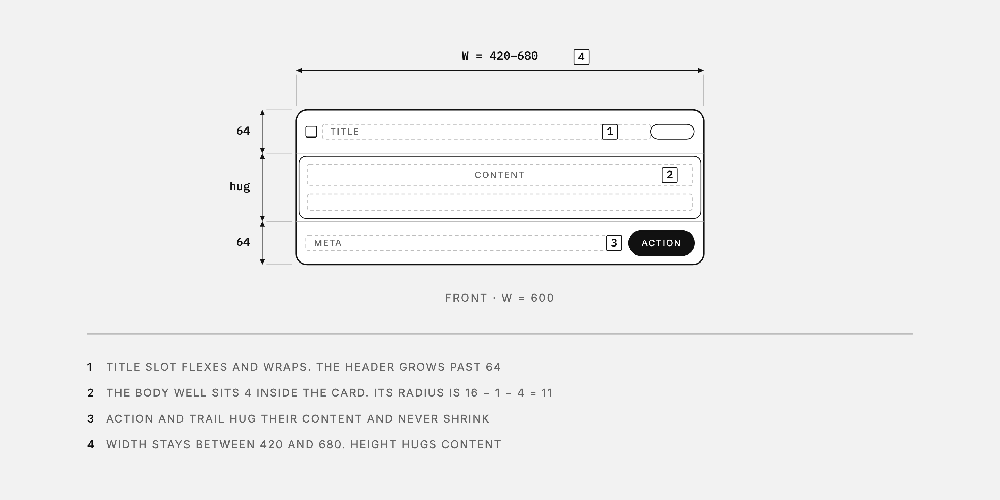
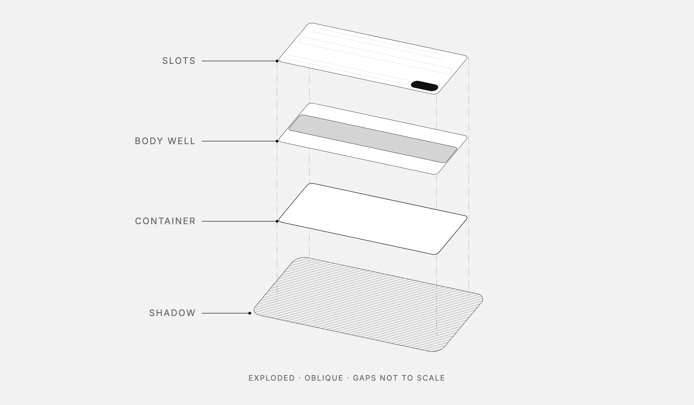
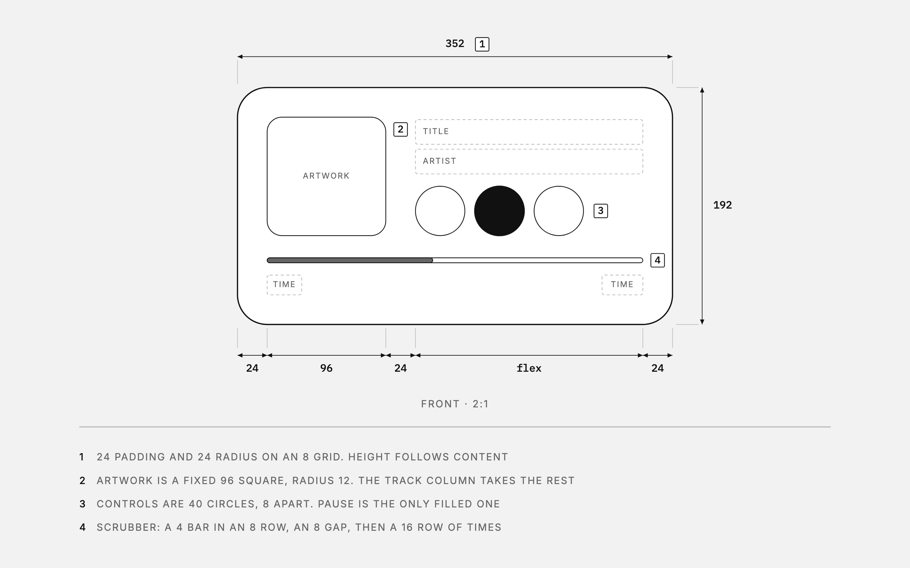

<p align="center">
  
</p>

<h1 align="center">diagram ✏️📐</h1>

<p align="center">
  <b>Give it a UI component or a product, get back a calm line drawing of it.</b><br>
  A few real dimensions and short labels for articles and docs, or a full Apple-style spec sheet when you need one.
</p>

<p align="center">
  <a href="#install">Install</a> ·
  <a href="#use-it">Use it</a> ·
  <a href="#make-it-move">Make it move</a> ·
  <a href="#examples">Examples</a>
</p>

---

This repo teaches your agent to draw **your components** as dimensional drawings, in two modes:

- **Diagram mode** (the default) draws one idea per figure, the kind that sits inside an article at full column width. You get a front view, a before and after, a sequence, a token scale, or an exploded stack, with a few real values and either direct labels or a short numbered notes list. Fewer marks always win.
- **Spec mode** draws the whole thing on one dense sheet, the way Apple's [dimensional drawings](https://developer.apple.com/accessories/dimensional-drawings/) do. You get a title block, a plan view, exploded layers, detail views and variable tables, enough for anyone to rebuild the component's *architecture*: paddings, gaps, radii, layers, how it sits in the viewport.

Copy and content are left out on purpose in both modes, so the drawing stays true when the text changes.

## What's inside 🎁

```
skills/
├── diagram/                      the drawing skill (both modes)
│   ├── SKILL.md
│   └── examples/                 single HTML files
│       ├── card-diagram.html         diagram mode: front view + oblique exploded stack
│       ├── media-player-diagram.html diagram mode: front view at 2:1, from Figma values
│       ├── card-sheet.html           spec mode
│       └── dialog-sheet.html         spec mode
└── diagram-motion/               turns a spec sheet into a ~10 s film
    ├── SKILL.md
    ├── templates/                reference scene + stylesheet
    └── adapters/
        ├── claude-motion.md      Claude's Motion artifact (primary)
        └── headless/             Playwright + ffmpeg, no Claude needed
```

### The house rules

These rules apply in both modes:

| | |
|---|---|
| ⚫️ **Monochrome** | grays only; things are told apart by line weight, dashes and hatches |
| 🧱 **Architecture, not content** | slots are dashed boxes with caps names: `TITLE`, `CONTENT`, `ACTION` |
| 🏷️ **Unbranded** | neutral names, no logos |
| 🙅 **Never invent values** | numbers come from the source (code, Figma, published specs); unknowns stay `[TBD]` |

The modes differ in how much they say:

| | Diagram mode | Spec mode |
|---|---|---|
| **Values** | real numbers on 2–5 dimensions (`24`, `W = 420–680`, `hug`) | variables tied to tables (`S1`, `R2 = R1 − B − S6`) |
| **Labels** | direct labels with leaders, or boxed numbers and a short notes list | notes block, part callouts, detail circles |
| **Views** | one figure per idea, often just the front | plan, exploded, details and tables on one sheet |
| **Theme** | follows the system's light or dark mode | light paper |

## Install

**Claude Code**

```bash
git clone https://github.com/clbhll/diagram
cp -r diagram/skills/* ~/.claude/skills/
```

To keep pulling updates, link the folders into place instead of copying them:

```bash
ln -s "$PWD/diagram/skills/diagram" ~/.claude/skills/diagram
ln -s "$PWD/diagram/skills/diagram-motion" ~/.claude/skills/diagram-motion
```

**claude.ai / Claude desktop:** zip a skill folder (for example `skills/diagram`) and add it under *Settings → Capabilities → Skills*.

**Any other agent** (Codex, Cursor, Gemini CLI, …): use the [`skills`](https://skills.sh) CLI, or point your agent at the `SKILL.md` files.

```bash
npx skills add clbhll/diagram
```

## Use it

Ask for a drawing and point at the source: a repo file, a Storybook story, a Figma link, a URL or a screenshot. With a Figma link, the skill reads exact sizes, paddings and radii through the Figma MCP server.

**Diagram mode** is what you get unless you ask for a spec:

> Diagram the `Card` component in `src/components/Card.tsx`

> Draw this Figma media player with its paddings and sizes: figma.com/design/…

> Show the upload state change as a before and after

An exploded view is never added by habit. Ask for one when the layering is the point, and pick a style or let the subject decide:

- **Oblique stack:** layers float apart on a slant, with labels on the left. It's the default for UI layers and token tiers.
- **Flat side elevation:** parts are stacked as flush horizontal profiles, with numbered callouts on the right. It's the default for physical products.

> Explode the card into its layers, oblique

**Spec mode** needs you to ask for it:

> Make a spec sheet of our settings dialog, same style as the examples

It works for physical things too (third-angle views, mm, published specs only). Try a thermos 🫖.

## Make it move 🎬

The motion skill animates a finished spec sheet like a pen drawing it while a camera moves over the paper:

<p align="center">
  
</p>

1. close-up on the header as its lines draw in
2. pull back to the plan view while the rest draws
3. layers lift off the plan into the exploded view (strokes first, fills after, so nothing flashes)
4. pull back to the full sheet as the remaining views draw in

The scene is a pure function of time, so it runs in two places:

| | |
|---|---|
| **With Claude** | ask *"animate this drawing"*. Claude builds it in the **Motion** artifact and you export MP4. This is the primary target and where the timing was tuned. |
| **Without Claude** | `cd skills/diagram-motion/adapters/headless && npm install`, then `node render.mjs --scene ../../templates/scene-dialog.js --css ../../templates/base.css --out dialog.mp4`. Needs Node 18+ and ffmpeg. |

> [!NOTE]
> Optimized for Claude Motion. The headless renderer is tested with Playwright (Chromium) + ffmpeg. Other animation libraries (Remotion, Motion Canvas, GSAP, Lottie…) are **not tested**.

## Examples

### Diagram mode

**Card, exploded**: an oblique stack of shadow, container, body well and slots



**Media player**: a front view at 2:1, measured from a Figma file



The card's front view is the image at the top of this page.

### Spec mode

**Dialog**: fixed width, scrim, viewport placement, header controls, footer actions


**Card**: flexible width, body well, nested corner, shadow envelope


Open the HTML versions in [`skills/diagram/examples`](skills/diagram/examples). The diagram-mode files switch to dark with your system theme. The full film is [`assets/dialog-motion.mp4`](assets/dialog-motion.mp4).

## Thanks 💌

- [Apple's accessory dimensional drawings](https://developer.apple.com/accessories/dimensional-drawings/), the north star for spec mode
- [Andreas Storm](https://x.com/avstorm), whose post started this
- [Enes Ozturk](https://github.com/enesozturk), who made the original [dimensional-drawing](https://github.com/enesozturk/dimensional-drawing) skill this repo is forked from

## License

MIT © Enes Ozturk. Draw all the things.
